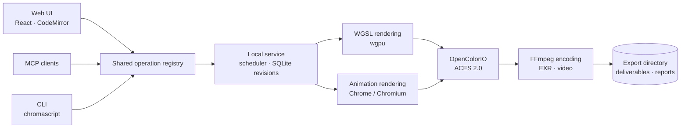
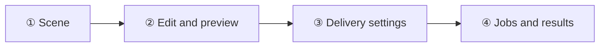
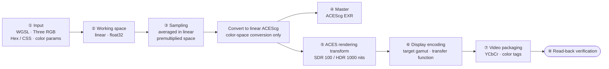

<div align="center">

# ChromaScript

**Create images with code. Preview, color-manage and deliver them on your own machine.**

A procedural video workbench built on ACES 2.0 · One service behind the web UI, MCP and CLI · Fully local rendering


**English** · [简体中文](README.md)

[Features](#features) ·
[Quick start](#quick-start) ·
[Authoring](#authoring) ·
[Color pipeline](#color-pipeline) ·
[Delivery](#delivery) ·
[Audio](#audio) ·
[MCP and CLI](#mcp-and-cli) ·
[Development](#development) ·
[FAQ](#faq)

</div>

---

## Features

| | |
| --- | --- |
| 🧪 **Three authoring engines** | WGSL shaders, Three.js float animation and React / Remotion SDR animation share one project, revision and delivery flow |
| 🎨 **Linear ACEScg workflow** | Masters carry no baked display transform, and alpha never enters color processing |
| 🖥️ **Live preview** | Live WGSL preview, frame-accurate timeline and a large-screen view; HDR preview on compatible displays |
| 📦 **Verifiable delivery** | EXR, ProRes, HEVC and H.264; the actual bitstream is read back and a verification report is written |
| 🔁 **Resumable jobs** | Jobs freeze source, color and environment, and resume only after their fingerprints are checked |
| 🔊 **Project audio** | Import, local synthesis, SoundFont scores and optional cloud narration and music, mixed into the delivery |
| 🤖 **Callable by models** | Every capability has an equivalent MCP tool and CLI command, backed by one operation registry |

All rendering happens offline on your machine. Cloud audio sends requests only when you call it and have configured a key.

## Architecture



See [docs/ARCHITECTURE.md](docs/ARCHITECTURE.md), [DESIGN.md](DESIGN.md) and [UX-CONTRACT.md](UX-CONTRACT.md).

## Quick start

### Requirements

| Dependency | Requirement |
| --- | --- |
| OS | macOS |
| Python | 3.12 |
| Node.js | 22.12+ |
| FFmpeg | `ffmpeg` and `ffprobe` on PATH, with the `libx264`, `libx265`, `prores_ks` and `dnxhd` encoders and the `zscale` filter |
| Browser | Chrome or Chromium for animation export; set a custom path with `CHROMASCRIPT_CHROME` |
| Optional | FluidSynth, for `create_music` |

### Install and run

```sh
cd /absolute/path/ChromaScript   # replace with your checkout path

./install.sh   # first install, and after every update: creates .venv, installs dependencies, builds the web app
./start.sh     # everyday launch
```

Open [http://127.0.0.1:8765](http://127.0.0.1:8765), create a project and add a blank scene. Press `Ctrl+C` to stop the service.

Optional `./start.sh` flags: `--workspace <path>` (data directory, default `workspace/`) and `--port <port>` (default `8765`).

## Authoring

| Engine | Good for | Output path |
| --- | --- | --- |
| **WGSL** | Procedural graphics, color experiments, parametric animation | Linear ACEScg → image sequence / video |
| **Three.js float**<br/>`three-float-v1` | HDR graphics, lighting, multi-chapter animation | RGBA32F → ACEScg EXR / video |
| **React SDR**<br/>`remotion-sdr-v1` | Text, DOM, SVG, ThreeCanvas | sRGB screenshots → SDR video |



- **WGSL**: `shade(ctx)` returns straight (non-premultiplied) linear ACEScg RGBA. RGB may be negative or above 1; alpha is 0–1.
- **Three.js float**: `three` is the only external package. The default export is `createScene({width, height, frames, fps, frameRate})`, returning `{scene, camera, update}`. Pick the authoring space with `source_color_space` (`Linear Rec.709 (sRGB)`, `Linear Rec.2020`, `ACEScg` or `ACES2065-1`; new scenes default to linear BT.2020). One scene can be split into chapter files with `files`; see the [multi-file example](examples/motion-chapters/README.md).
- **React SDR**: React, Remotion, ThreeCanvas and Three.js imports are allowed. SDR provides no float master.

[examples/](examples/README.md) has six scenes (exposure ramp, wide-gamut gradient, shapes and transparency, spiral particles, procedural noise, animated chart) and sample call parameters for the other operations.

## Color pipeline

The following pipeline applies to **WGSL and the Three.js float engine**. Images are generated and composited in linear floating point: WGSL uses ACEScg directly, while Three uses its chosen authoring space before conversion to ACEScg. Previews and display deliveries each apply one ACES output transform. EXR masters have no display look baked in, so the same scene data can produce SDR, HDR or a grading intermediate.

React SDR uses a separate 8-bit sRGB screenshot path. Compositing and downsampling happen in display-linear sRGB light, without an ACES scene output transform or a float master.



| Stage | Behavior |
| --- | --- |
| **Input** | WGSL return values are read as linear ACEScg; numeric Three RGB is read in the chosen authoring space (`source_color_space`). Hex / CSS colors are read as sRGB and converted in. WGSL color parameters are converted from their declared `color_space` to linear ACEScg. Do not bake tone mapping or display encoding into code |
| **Working space** | Linear float32, keeping negative values and highlights above 1: ACEScg for WGSL, the chosen authoring space for Three animation (default linear BT.2020). Alpha **never enters OCIO** |
| **Sampling** | Averaged in linear premultiplied RGB / alpha, then unpremultiplied. WGSL defaults to 4 samples; Three animation defaults to 2×2 spatial sampling |
| **Master** | Float read-back → OCIO conversion to ACEScg (alpha bypassed) → EXR, with no display look baked in |
| **ACES rendering transform** | Tone mapping and gamut processing use the target peak luminance and limiting gamut. Video without alpha is first composited over black in linear light |
| **Display encoding** | Encodes for the target gamut and transfer function. Switching between pure Gamma 2.2/2.4/2.6 within the same SDR rendering view changes only display encoding; switching between SDR and HDR changes the rendering view |
| **Video packaging** | In the CPU reference path, SDR/PQ is clamped to 0–1 and quantized to 16-bit RGB first; HLG Limited YCbCr keeps float32 RGB through matrix and range conversion. The GPU video path quantizes and packs YCbCr after float processing. Encoding writes the corresponding color tags |
| **Verification** | Reads back the actual primaries, transfer, matrix and range, then decodes strictly. ACEScct intermediates also have their explicit declaration checked. Verification mismatches fail explicitly |

Steps ⑤ ACES rendering and ⑥ display encoding together form the complete **ACES Output Transform**; display encoding is not applied twice. sRGB, PQ and HLG are not single power-law exponents.

The HLG Limited YCbCr path preserves super-whites within its actual storage code range. Values outside that range, or HLG values that Full/RGB integer outputs cannot represent, are rejected. Selecting Limited alone does not guarantee super-white preservation in every encoding path.

### Configuration and output spaces

The pipeline extends OpenColorIO's built-in CG config `cg-config-v4.0.0_aces-v2.0_ocio-v2.5` with HLG and selected pure-gamma display encodings. The base config has no HLG display, so OCIO's official built-in transform `DISPLAY - CIE-XYZ-D65_to_REC.2100-HLG-1000nit` fills the gap. `list_color_spaces` and `list_output_transforms` return the extended config's checksum, available spaces and output views; `convert_colors` converts 1–4096 RGB samples per call.

| Output | Gamut / transfer | ACES rendering view |
| --- | --- | --- |
| `sRGB` | Rec.709 / sRGB | SDR 100 nits, Rec.709 limiting gamut |
| `Rec.709` | Rec.709 / BT.1886 (Gamma 2.4 at ideal black) | SDR 100 nits, Rec.709 limiting gamut |
| `Display-P3` | P3-D65 / sRGB | SDR 100 nits, P3-D65 limiting gamut |
| `PQ` | Rec.2020 / ST 2084 | HDR 1000 nits, Rec.2020 limiting gamut |
| `P3-PQ` | P3-D65 / ST 2084 | HDR 1000 nits, P3-D65 limiting gamut |
| `HLG` | Rec.2020 / ARIB STD-B67 | Shares PQ's HDR 1000-nit rendering with a Rec.2020 limiting gamut |
| `ACEScg` · `ACES2065-1` · `ACEScct` | AP1 linear · AP0 linear · AP1 log | Pure color-space conversion, no display rendering |

The HLG implementation takes the PQ view result and re-encodes it through the CIE XYZ D65 display reference space into HLG, without another tone map. The 100/1000-nit values are the current rendering views' target peaks, not intrinsic luminance limits of the transfer-function names.

The table lists the main pixel transforms, not support for every container. Standard video deliveries require exact standardized gamut and transfer tags, so pure Gamma 2.4/2.6 video combinations are disabled rather than substituted with notes or incorrect tags.

**The ACEScct ProRes 4444 grading intermediate is an explicitly declared exception.** Standard primaries and transfer tags are unspecified (MOV `colr=2/2/1`, where BT.709 identifies only the YCbCr packing matrix). A MOV declaration and `color-encoding.json` record AP1/D60, ACEScct and the data range. Resolve imports require manually selecting ACEScct and Video data levels; declaration verification does not certify automatic recognition or an in-app import. Consult the delivery panel, `get_delivery_options` or the animation-specific `get_motion_delivery_options` for available combinations.

> [!IMPORTANT]
> - **A tag is not a conversion.** Tagging a Rec.709 picture as P3 does not create a wider gamut. Changing only `source_color_space` reinterprets the numbers; use `upgrade_motion_scene` to preserve color.
> - **The preview is not a monitor.** The WGSL web preview always uses the ACES 2.0 sRGB SDR transform, independent of delivery settings, and says nothing about true luminance or full gamut.

## Delivery

Each submission freezes the source, audio track, color configuration and rational frame rate. After export, the actual codec, bit depth, sampling and color tags are read back.

| Capability | Details |
| --- | --- |
| **EXR master** | ACEScg, 16 / 32-bit, ZIP compression |
| **Video** | HEVC Main10, H.264, Apple ProRes 422 HQ, and a ProRes 4444 ACEScct 12-bit grading intermediate |
| **Video only** | Frames go straight into the encoder; no EXR is written |
| **Hardware encoding** | VideoToolbox is tested at submission; auto mode freezes a software plan if it fails |
| **Parallel rendering** | Float animation can use 1 / 2 / 4 workers (`output.render_workers`) |
| **Disk estimate** | `estimate_motion_render` estimates deliverable size and peak disk use |
| **Export directory** | Any writable directory or external drive; existing files are never overwritten |

For full fields and limits, read the built-in docs: `get_documentation(topic="motion")` and `topic="motion-color"`. For DaVinci Resolve import settings, see [docs/RESOLVE_IMPORT.md](docs/RESOLVE_IMPORT.md).

## Audio

The Sound stage has direction auditions, a timeline and audio assets. Deliveries mix the frozen track revision and add an exact-length `audio.wav`. Assets are stored as 48 kHz stereo 32-bit PCM WAV.

| Source | Operation | Notes |
| --- | --- | --- |
| Import | `import_audio` | Local absolute path or Base64, up to 128 MiB |
| Local synthesis | `create_audio` | Sine, triangle, noise and timed events |
| SoundFont score | `inspect_soundfont` · `create_music` | Local SF2 + FluidSynth, up to 15 parts |
| Cloud narration | `generate_speech` | OpenRouter Gemini TTS, **may cost money** |
| Cloud music | `generate_music` | OpenRouter Lyria, optional reference images, **may cost money** |
| Cloud analysis | `analyze_media` | Gemini text / audio analysis, **may cost money** |
| Local review | `review_audio` | Connects to a local llama.cpp-compatible server |

Arrange the track with `get_project_audio` → `set_project_audio(expected_revision_id, timeline)`. Production guidelines come from `get_audio_guidelines(project_id)`.

### Cloud audio setup

Cloud features are off by default. Copy `.env.example` to `.env` and add your key:

```sh
cp .env.example .env && chmod 600 .env
```

```dotenv
OPENROUTER_API_KEY=your-openrouter-key
OPENROUTER_TTS_MODEL=google/gemini-3.8-flash-tts
OPENROUTER_TTS_VOICE=Kore
OPENROUTER_MUSIC_MODEL=google/lyria-3-pro-preview
OPENROUTER_ANALYSIS_MODEL=google/gemini-3.8-flash
OPENROUTER_REQUIRE_ZDR=true
```

- Precedence: service process environment > `<workspace>/.env` > `<workspace parent>/.env`.
- Requests require zero data retention (ZDR) and deny data collection by default. With no compliant provider they fail rather than downgrade.
- Every call needs an `idempotency_key`; retrying with the same key returns the existing result and does not bill twice.
- Prompts, lines and any reference images you pick are sent to OpenRouter and its providers. Never give the key to an agent or commit it to Git.
- Raw production records are kept, unencrypted, in `speech-sources/`, `music-sources/` and `analysis-sources/`.

## MCP and CLI

### Connect an MCP client

Run `./install.sh` first, then run one of these from the repository root. Paths come from the current directory, so there is nothing to replace.

**Claude Code**

```sh
claude mcp add chromascript -- "$PWD/.venv/bin/chromascript" --workspace "$PWD/workspace" mcp
```

Add `-s user` to make it available in every project; by default it applies to the current project only.

**Codex**

```sh
codex mcp add chromascript -- "$PWD/.venv/bin/chromascript" --workspace "$PWD/workspace" mcp
```

**Let an agent do it**: send this to Claude Code or Codex.

> In the ChromaScript repository root, run `./install.sh` (skip it if already installed), then register this repository as an MCP server named chromascript. The command is the absolute path of `.venv/bin/chromascript`, and the arguments are `--workspace <absolute repository path>/workspace mcp`. After adding it, list the configured MCP servers to confirm it appears, and remind me to restart the client.

**Other clients**: add this to the client's config, replacing both placeholder paths.

```json
{
  "mcpServers": {
    "chromascript": {
      "command": "/absolute/path/ChromaScript/.venv/bin/chromascript",
      "args": ["--workspace", "/absolute/path/ChromaScript/workspace", "mcp"]
    }
  }
}
```

The web app started by MCP always uses `http://127.0.0.1:8765`. Native MCP tools wrap their arguments as `{"request": {...}}`; HTTP and CLI arguments stay flat. After upgrading the code, restart the service and reconnect MCP.

While the service runs, read the calling conventions with `get_documentation(topic=...)` or the MCP resource `chromascript://docs/<topic>`. Topics: `scene`, `workflow`, `motion`, `motion-color`, `audio`, `auditions`.

### Command line

Use `.venv/bin/chromascript` from the repository root:

| Command | Purpose |
| --- | --- |
| `serve` | Start the web and HTTP service |
| `mcp` | Start the MCP stdio adapter |
| `doctor` | Check the local environment |
| `operations` | List every shared operation |
| `call <operation> --arguments <JSON or @file>` | Call any shared operation |
| `preview` · `render` · `inspect` | Preview a scene, render, inspect a result |
| `resume <job-id>` | Resume an interrupted job |

```sh
.venv/bin/chromascript call list_motion_templates
.venv/bin/chromascript call estimate_motion_render --arguments '{"settings":{"width":3840,"height":2160,"frames":300,"fps":{"numerator":60,"denominator":1}},"output":{"master_bit_depth":32,"video":"none","render_scale":2}}'
```

## Data and storage

Data is stored in `workspace/` by default (ignored by Git). Each project has its own folder, where `project.sqlite3` is the source of truth for revisions and the other files are readable exports. `workspace/server.json` holds an access token; do not share it.

To back up, use `export_project_folder`, or stop the service and copy the whole project folder. Never copy just the SQLite file of a running service. Use `clone_project` for an independent copy.

### Independent output frame rate and temporal sampling

The animation's `fps / frames` remain its authoring timebase. Choose an output rate under delivery settings for a temporary 30fps export; `output.fps=null` inherits the project. A 600-frame / 60fps source becomes 300 frames / 30fps, preserving its 10-second timing.

`output.temporal_samples=1` holds the preceding source frame; `4 / 8 / 16` integrate centered shutter samples (`output.shutter_angle`, default 180°). Source code must be deterministic and seekable at fractional source frames, without per-call motion accumulation. Non-integral durations round output count up, holding the tail for less than one output frame; the actual duration is reported.

Output review renders 1–60 frames with final spatial/temporal sampling, then resizes sRGB display copies for one-shot playback at the output rate. It creates no jobs/revisions and marks retained images stale when settings change. Review is before codec compression and does not represent HDR display appearance.

HTTP, MCP and CLI share `get_motion_time_plan`, `render_motion_output_preview`, optional `output` on `render_motion_frame`, and `submit_motion_render`. Example output arguments:

```json
{"output":{"fps":{"numerator":30,"denominator":1},"temporal_samples":8,"shutter_angle":180,"master_bit_depth":32,"video":"srgb"}}
```

## Development

```sh
# Backend
.venv/bin/python -m pytest tests/test_rendering.py tests/test_live_preview.py -q
.venv/bin/ruff check src tests
.venv/bin/mypy src

# Frontend
npm --prefix frontend run test:unit
npm --prefix frontend run typecheck
npm --prefix frontend run lint
npm --prefix frontend run build
```

Web end-to-end tests use headless Playwright WebKit. Start a separate test workspace first:

```sh
.venv/bin/chromascript --workspace /tmp/chromascript-test serve --port 8875
# In another terminal:
CHROMASCRIPT_URL=http://127.0.0.1:8875 npm --prefix frontend run test:e2e -- tests/live-preview.spec.ts
```

Export pipeline tests and benchmark:

```sh
.venv/bin/python -m pytest tests/test_export_pipeline.py tests/test_frame_manifest.py -q
.venv/bin/python scripts/benchmark_exports.py --baseline-ref BASELINE_COMMIT --output /tmp/chromascript-export-benchmark
```

After editing `DESIGN.md`, a script regenerates the UI tokens; commit both together. Contribution conventions are in [AGENTS.md](AGENTS.md) and [UX-CONTRACT.md](UX-CONTRACT.md).

## FAQ

<details>
<summary><strong>The service won't start, or the web page won't open?</strong></summary>

Read the error in the terminal that launched it. If it reports an incomplete install, run `./install.sh`. If the port is taken, run `./start.sh --port 8766`.
</details>

<details>
<summary><strong>The UI didn't change after an update?</strong></summary>

Run `./install.sh` again, restart the service and refresh the page. If the existing `.venv` is incompatible, move that directory away before installing.
</details>

<details>
<summary><strong>Export options are unavailable, or rendering fails?</strong></summary>

Run `.venv/bin/chromascript doctor` and read the job error. If an encoder or filter is missing, install a complete FFmpeg and restart the service.
</details>

<details>
<summary><strong>Colors look different after importing into DaVinci Resolve?</strong></summary>

Check the input color space, gamma and data level against the delivery report. See [Resolve import notes](docs/RESOLVE_IMPORT.md).
</details>

<details>
<summary><strong>How do I continue after an interrupted render?</strong></summary>

Run `.venv/bin/chromascript resume <job-id>`. Resuming checks the source, color configuration, GPU backend and runtime fingerprint; if any of them changed it is refused and the job must be resubmitted.
</details>

<details>
<summary><strong>How do I change the data or export directory?</strong></summary>

Use `./start.sh --workspace /path/to/data` for data. Choose the export directory in the delivery panel, or type any writable absolute path.
</details>

## License

[MIT](LICENSE) © 2026 RaSteaks
