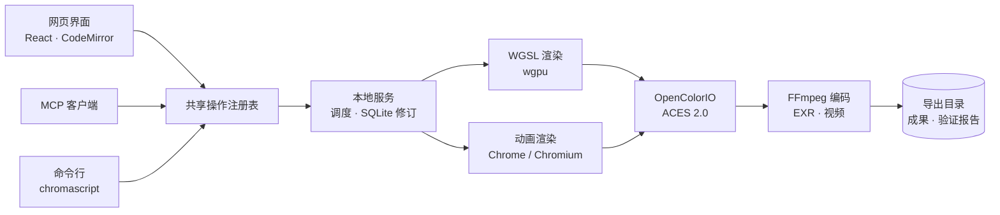
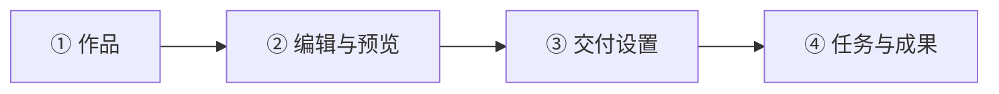
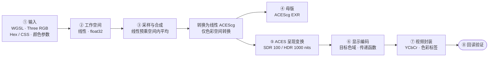

<div align="center">

# ChromaScript

**用代码创作画面，在本机完成预览、色彩管理与交付。**

ACES 2.0 程序化视频工作台 · 网页 / MCP / CLI 三端同源 · 全程本地渲染


[English](README.en.md) · **简体中文**

[特性](#特性) ·
[快速开始](#快速开始) ·
[创作方式](#创作方式) ·
[色彩管线](#色彩管线) ·
[交付](#交付) ·
[音频](#音频) ·
[MCP 与 CLI](#mcp-与-cli) ·
[开发](#开发) ·
[常见问题](#常见问题)

</div>

---

## 特性

| | |
| --- | --- |
| 🧪 **三种创作引擎** | WGSL 着色器、Three.js 浮点动画、React / Remotion SDR 动画，共用项目、修订与交付流程 |
| 🎨 **线性 ACEScg 工作流** | 母版不烘焙显示变换，Alpha 不参与色彩转换 |
| 🖥️ **实时预览** | WGSL 实时预览、逐帧时间线、大屏查看；兼容设备上可预览 HDR |
| 📦 **可验证的交付** | EXR、ProRes、HEVC、H.264；导出后回读实际码流并生成验证报告 |
| 🔁 **可恢复的任务** | 任务冻结源码、色彩与环境，中断后校验指纹再恢复 |
| 🔊 **项目音频** | 导入、本地合成、SoundFont 配乐、可选云端配音与配乐，随交付混音 |
| 🤖 **模型可调用** | 每项能力都有等效的 MCP 工具与 CLI 命令，共用一个操作注册表 |

渲染全部在本机离线完成。云端音频仅在你主动调用并配置密钥后才会发出请求。

## 架构



详见 [docs/ARCHITECTURE.md](docs/ARCHITECTURE.md)、[DESIGN.md](DESIGN.md) 与 [UX-CONTRACT.md](UX-CONTRACT.md)。

## 快速开始

### 环境要求

| 依赖 | 要求 |
| --- | --- |
| 系统 | macOS |
| Python | 3.12 |
| Node.js | 22.12+ |
| FFmpeg | `ffmpeg`、`ffprobe` 在 PATH 中，含 `libx264`、`libx265`、`prores_ks`、`dnxhd` 编码器与 `zscale` 滤镜 |
| 浏览器 | 动画导出需要 Chrome 或 Chromium，自定义路径用 `CHROMASCRIPT_CHROME` |
| 可选 | FluidSynth，用于 `create_music` |

### 安装与启动

```sh
cd /absolute/path/ChromaScript   # 替换为本机仓库路径

./install.sh   # 首次安装或更新后运行：创建 .venv、装依赖、构建网页
./start.sh     # 日常启动
```

打开 [http://127.0.0.1:8765](http://127.0.0.1:8765)，创建项目并新建空白场景。`Ctrl+C` 停止服务。

`./start.sh` 可选参数：`--workspace <路径>`（数据目录，默认 `workspace/`）、`--port <端口>`（默认 `8765`）。

## 创作方式

| 引擎 | 适合内容 | 输出路径 |
| --- | --- | --- |
| **WGSL** | 程序图形、色彩实验、参数化动画 | 线性 ACEScg → 图像序列 / 视频 |
| **Three.js 浮点**<br/>`three-float-v1` | HDR 图形、光效、多章节动画 | RGBA32F → ACEScg EXR / 视频 |
| **React SDR**<br/>`remotion-sdr-v1` | 文字、DOM、SVG、ThreeCanvas | sRGB 截图 → SDR 视频 |



- **WGSL**：`shade(ctx)` 返回非预乘的线性 ACEScg RGBA，RGB 可为负或大于 1，Alpha 取 0–1。
- **Three.js 浮点**：外部包仅允许 `three`；默认导出 `createScene({width, height, frames, fps, frameRate})`，返回 `{scene, camera, update}`。通过 `source_color_space` 选择创作空间（`Linear Rec.709 (sRGB)`、`Linear Rec.2020`、`ACEScg`、`ACES2065-1`，新建默认线性 BT.2020）。单场景可用 `files` 拆成多个分章文件，见[多文件示例](examples/motion-chapters/README.md)。
- **React SDR**：允许 React、Remotion、ThreeCanvas 与 Three.js 导入。SDR 不提供浮点母版。

[examples/](examples/README.md) 提供六个场景示例（曝光阶梯、广色域渐变、几何与透明度、螺旋粒子、程序纹理、动态图表）和各类调用参数样例。

## 色彩管线

以下管线适用于 **WGSL 与 Three.js 浮点引擎**：画面在线性浮点里生成与合成，WGSL 直接使用 ACEScg，Three 使用所选创作空间，再转入 ACEScg。预览和显示交付各自应用一次 ACES 输出变换；EXR 母版不烘焙显示效果，同一份场景数据可输出 SDR、HDR 或调色中间片。

React SDR 使用独立的 8-bit sRGB 截图路径，仅在线性 sRGB 显示光中合成与缩采样，不应用 ACES 场景输出变换，也不产生浮点母版。



| 阶段 | 说明 |
| --- | --- |
| **输入** | WGSL 返回值按线性 ACEScg 解释；Three 数值 RGB 按所选创作空间（`source_color_space`）解释；Hex / CSS 颜色按 sRGB 解释并转入；WGSL 颜色参数按声明的 `color_space` 转为线性 ACEScg。
| **工作空间** | 线性 float32，保留负值与大于 1 的高光：WGSL 为 ACEScg，Three 动画为所选创作空间（默认线性 BT.2020）。Alpha 不进入 OCIO |
| **采样与合成** | 在线性预乘 RGB / Alpha 中平均后解除预乘。WGSL 默认 4 次采样，Three 动画默认 2×2 空间采样 |
| **母版** | 浮点读取 → OCIO 转为 ACEScg（Alpha 不参与）→ EXR，不烘焙显示效果 |
| **ACES 呈现变换** | 按目标峰值亮度和限制色域进行 tone mapping 与色域处理；视频不带 Alpha 时，先在线性光中合成到黑底 |
| **显示编码** | 按目标色域与传递函数编码。在相同 SDR 呈现视图下切换纯 Gamma 2.2/2.4/2.6，仅改变显示编码；切换 SDR/HDR 则会改变呈现视图 |
| **视频封装** | CPU 参考路径中，SDR/PQ 先裁剪至 0–1 并量化为 16-bit RGB，HLG Limited YCbCr 保留 float32 RGB 至矩阵与范围转换；GPU 视频路径在浮点处理后直接量化、打包 YCbCr。编码时写入对应色彩标签 |
| **回读验证** | 回读实际 primaries、transfer、matrix、range 并严格解码；ACEScct 中间片另校验显式声明。验证不符时明确失败 |

图中的⑤ ACES 呈现变换与⑥显示编码共同组成完整的 **ACES Output Transform**，不会重复应用显示编码。sRGB、PQ、HLG 均不是单一的幂指数。

HLG Limited YCbCr 路径保留实际码值范围允许的超白；超出该范围，或 Full/RGB 整数输出无法表示的 HLG 值，会明确拒绝。选择 Limited 本身不保证所有编码路径都保留超白。

### 色彩配置与输出空间

以 OpenColorIO 内置的 CG 配置 `cg-config-v4.0.0_aces-v2.0_ocio-v2.5` 为基础，增加 HLG 和部分纯 Gamma 显示编码。基础配置没有 HLG 显示，由 OCIO 官方内置变换 `DISPLAY - CIE-XYZ-D65_to_REC.2100-HLG-1000nit` 补齐。`list_color_spaces`、`list_output_transforms` 返回扩展后的配置校验和、可用空间与输出视图，`convert_colors` 支持一次换算 1–4096 个 RGB 样本。

| 输出 | 色域 / 传递函数 | ACES 呈现视图 |
| --- | --- | --- |
| `sRGB` | Rec.709 / sRGB | SDR 100 nits，Rec.709 限制色域 |
| `Rec.709` | Rec.709 / BT.1886（理想黑位下 Gamma 2.4） | SDR 100 nits，Rec.709 限制色域 |
| `Display-P3` | P3-D65 / sRGB | SDR 100 nits，P3-D65 限制色域 |
| `PQ` | Rec.2020 / ST 2084 | HDR 1000 nits，Rec.2020 限制色域 |
| `P3-PQ` | P3-D65 / ST 2084 | HDR 1000 nits，P3-D65 限制色域 |
| `HLG` | Rec.2020 / ARIB STD-B67 | 与 PQ 共用 HDR 1000 nits、Rec.2020 限制色域的呈现 |
| `ACEScg` · `ACES2065-1` · `ACEScct` | AP1 线性 · AP0 线性 · AP1 对数 | 纯色彩空间转换，不做显示渲染 |

HLG 实现先取得 PQ 视图结果，再经显示参考空间 CIE XYZ D65 转为 HLG 显示编码，不会再次 tone map。100/1000 nits 是当前呈现视图的目标峰值，不是传递函数名称固有的亮度上限。

上表列出主要像素变换，不代表所有封装都支持对应交付。常规视频交付要求精确的标准色域与传递函数标签，纯 Gamma 2.4/2.6 视频组合因此禁用，不以备注或错误标签替代。

**ACEScct ProRes 4444 调色中间片是显式声明的例外**：标准色域与传递函数标签均为未指定（MOV `colr=2/2/1`，其中 BT.709 仅表示 YCbCr 打包矩阵），AP1/D60、ACEScct 和数据范围由 MOV 声明与 `color-encoding.json` 记录。导入 Resolve 时须手动指定 ACEScct 和 Video 数据范围；声明验证不等于自动识别或应用内导入认证。可用组合以交付面板、`get_delivery_options` 或动画专用的 `get_motion_delivery_options` 为准。

> [!IMPORTANT]
> - **标签不等于转换。** 把 Rec.709 画面标成 P3 不会产生更宽的色域；只改 `source_color_space` 会重新解释数值，保色请用 `upgrade_motion_scene`。
> - **预览不代替监看。** WGSL 网页预览固定使用 ACES 2.0 sRGB SDR 变换，不随交付设置改变，也不能推定真实亮度或完整色域。

## 交付

每次提交冻结源码、音轨、色彩配置与有理数帧率，导出后回读实际 codec、位深、采样与色彩标签。

| 能力 | 说明 |
| --- | --- |
| **EXR 母版** | ACEScg 16 / 32-bit，ZIP 压缩 |
| **视频** | HEVC Main10、H.264、Apple ProRes 422 HQ、ProRes 4444 ACEScct 12-bit 中间片 |
| **仅视频** | 逐帧直接送入编码器，不写 EXR |
| **硬件编码** | 提交时实测 VideoToolbox，自动模式失败则冻结为软件方案 |
| **并行渲染** | 浮点动画可选 1 / 2 / 4 路并发（`output.render_workers`） |
| **磁盘预估** | `estimate_motion_render` 估算成品体积与峰值占用 |
| **导出目录** | 任意可写目录或外部硬盘，已有文件不覆盖 |

完整字段与限制见内置文档 `get_documentation(topic="motion")` 与 `topic="motion-color"`。导入 DaVinci Resolve 的设置见 [docs/RESOLVE_IMPORT.md](docs/RESOLVE_IMPORT.md)。

## 音频

「声音」阶段包含方向试听、时间线与音频素材。交付按冻结的音轨修订混音，并附精确时长的 `audio.wav`。素材统一存为 48 kHz 双声道 32-bit PCM WAV。

| 来源 | 操作 | 说明 |
| --- | --- | --- |
| 导入 | `import_audio` | 本地绝对路径或 Base64，最多 128 MiB |
| 本地合成 | `create_audio` | 正弦、三角、噪声与定时事件 |
| SoundFont 配乐 | `inspect_soundfont` · `create_music` | 本地 SF2 + FluidSynth，最多 15 声部 |
| 云端配音 | `generate_speech` | OpenRouter Gemini TTS，**可能付费** |
| 云端配乐 | `generate_music` | OpenRouter Lyria，可附参考图，**可能付费** |
| 云端分析 | `analyze_media` | Gemini 文本／音频分析，**可能付费** |
| 本地听审 | `review_audio` | 连接本机 llama.cpp 兼容服务 |

编排音轨用 `get_project_audio` → `set_project_audio(expected_revision_id, timeline)`；制作规范由 `get_audio_guidelines(project_id)` 返回。

### 云端音频配置

云端功能默认关闭。复制 `.env.example` 为 `.env`，填入密钥：

```sh
cp .env.example .env && chmod 600 .env
```

```dotenv
OPENROUTER_API_KEY=你的OpenRouter密钥
OPENROUTER_TTS_MODEL=google/gemini-3.8-flash-tts
OPENROUTER_TTS_VOICE=Kore
OPENROUTER_MUSIC_MODEL=google/lyria-3-pro-preview
OPENROUTER_ANALYSIS_MODEL=google/gemini-3.8-flash
OPENROUTER_REQUIRE_ZDR=true
```

- 读取优先级：服务进程环境变量 > `<workspace>/.env` > `<workspace 父目录>/.env`。
- 请求默认要求零数据留存（ZDR）且拒绝数据收集；无合规提供商则失败，不自动降级。
- 每次调用需要 `idempotency_key`，同键重试返回已有结果，不重复付费。
- 提示词、台词与指定的参考图会发送给 OpenRouter 及其提供商。密钥不要发给 Agent，也不要提交 Git。
- 原始制作记录保存在 `speech-sources/`、`music-sources/`、`analysis-sources/`，未加密。

## MCP 与 CLI

### 接入 MCP 客户端

先完成 `./install.sh`，然后在仓库根目录执行（路径取自当前目录，无需手动替换）。

**Claude Code**

```sh
claude mcp add chromascript -- "$PWD/.venv/bin/chromascript" --workspace "$PWD/workspace" mcp
```

加 `-s user` 可对所有项目生效；默认只对当前项目生效。

**Codex**

```sh
codex mcp add chromascript -- "$PWD/.venv/bin/chromascript" --workspace "$PWD/workspace" mcp
```

**让 Agent 代劳**：把下面这段话发给 Claude Code 或 Codex。

> 请在 ChromaScript 仓库根目录运行 `./install.sh`（如已安装可跳过），然后把本仓库注册为名为 chromascript 的 MCP 服务：命令是 `.venv/bin/chromascript` 的绝对路径，参数为 `--workspace <仓库绝对路径>/workspace mcp`。添加后列出已配置的 MCP 服务确认它出现，并提醒我重启客户端。

**其他客户端**：在配置中加入以下内容，替换两处占位路径。

```json
{
  "mcpServers": {
    "chromascript": {
      "command": "/absolute/path/ChromaScript/.venv/bin/chromascript",
      "args": ["--workspace", "/absolute/path/ChromaScript/workspace", "mcp"]
    }
  }
}
```

MCP 启动的网页固定使用 `http://127.0.0.1:8765`。原生 MCP 工具的参数包装为 `{"request": {...}}`，HTTP / CLI 参数保持扁平。升级代码后需重启服务并重新连接 MCP。

服务运行时，可用 `get_documentation(topic=...)` 或 MCP 资源 `chromascript://docs/<主题>` 读取调用约定，主题有 `scene`、`workflow`、`motion`、`motion-color`、`audio`、`auditions`。

### 命令行

在仓库根目录使用 `.venv/bin/chromascript`：

| 命令 | 作用 |
| --- | --- |
| `serve` | 启动网页与 HTTP 服务 |
| `mcp` | 启动 MCP stdio 适配器 |
| `doctor` | 检查本机环境 |
| `operations` | 列出全部共享操作 |
| `call <操作> --arguments <JSON 或 @文件>` | 调用任意共享操作 |
| `preview` · `render` · `inspect` | 预览场景、渲染、检查成果 |
| `resume <job-id>` | 恢复中断的任务 |

```sh
.venv/bin/chromascript call list_motion_templates
.venv/bin/chromascript call estimate_motion_render --arguments '{"settings":{"width":3840,"height":2160,"frames":300,"fps":{"numerator":60,"denominator":1}},"output":{"master_bit_depth":32,"video":"none","render_scale":2}}'
```

## 数据与存储

数据默认保存在 `workspace/`（Git 忽略）。每个项目有独立文件夹，其中 `project.sqlite3` 是修订的数据来源，其余文件是便于查看的导出。`workspace/server.json` 含访问令牌，请勿分享。

备份用 `export_project_folder`，或先停止服务再复制整个项目文件夹，不要只复制运行中的 SQLite 文件。独立副本用 `clone_project`。

### 独立输出帧率与运动采样

动画项目的 `fps / frames` 始终是创作时基。临时导出 30fps 时，在“设置交付 → 输出时间”选择输出帧率，不修改项目帧率。`output.fps=null` 默认跟随项目；例如 600 帧 / 60fps 导出为 300 帧 / 30fps，仍为 10 秒。

`output.temporal_samples=1` 快速抽取前一源帧；`4 / 8 / 16` 在中心曝光区间内求值并合成，`output.shutter_angle` 默认 180°。源码必须支持绝对时间和小数源帧，不能按调用次数累加运动。非整除时输出帧数向上取整，尾部保持不足一帧，实际时长会显示在界面和时间计划中。

“生成输出预览”按正式空间与时间采样生成 1–60 帧，并缩小为 sRGB 查看图；按输出帧率播放一次。预览不写项目修订、不创建任务，设置变化后标记旧画面失效。它展示编码前的采样，不包含有损编码误差或 HDR 显示效果。

HTTP、MCP 与 CLI 共用 `get_motion_time_plan`、`render_motion_output_preview`、`render_motion_frame(..., output=...)` 和 `submit_motion_render`。例如提交时指定：

```json
{"output":{"fps":{"numerator":30,"denominator":1},"temporal_samples":8,"shutter_angle":180,"master_bit_depth":32,"video":"srgb"}}
```

## 开发

```sh
# 后端
.venv/bin/python -m pytest tests/test_rendering.py tests/test_live_preview.py -q
.venv/bin/ruff check src tests
.venv/bin/mypy src

# 前端
npm --prefix frontend run test:unit
npm --prefix frontend run typecheck
npm --prefix frontend run lint
npm --prefix frontend run build
```

网页端到端测试使用 Playwright WebKit（headless），先启动独立的测试工作区：

```sh
.venv/bin/chromascript --workspace /tmp/chromascript-test serve --port 8875
# 另一个终端：
CHROMASCRIPT_URL=http://127.0.0.1:8875 npm --prefix frontend run test:e2e -- tests/live-preview.spec.ts
```

导出管线测试与基准：

```sh
.venv/bin/python -m pytest tests/test_export_pipeline.py tests/test_frame_manifest.py -q
.venv/bin/python scripts/benchmark_exports.py --baseline-ref BASELINE_COMMIT --output /tmp/chromascript-export-benchmark
```

修改 `DESIGN.md` 后由脚本生成 UI tokens，两者一起提交。贡献约定见 [AGENTS.md](AGENTS.md) 与 [UX-CONTRACT.md](UX-CONTRACT.md)。

## 常见问题

<details>
<summary><strong>服务无法启动或网页打不开？</strong></summary>

查看启动终端的报错。提示安装不完整时运行 `./install.sh`；端口被占用时运行 `./start.sh --port 8766`。
</details>

<details>
<summary><strong>更新后界面没变化？</strong></summary>

重新运行 `./install.sh`，重启服务并刷新网页。已有 `.venv` 不兼容时，先将该目录移走再安装。
</details>

<details>
<summary><strong>导出选项不可用或渲染失败？</strong></summary>

运行 `.venv/bin/chromascript doctor` 并查看任务错误。缺少编码器或滤镜时安装完整的 FFmpeg 后重启服务。
</details>

<details>
<summary><strong>导入 DaVinci Resolve 后颜色不一致？</strong></summary>

按交付报告核对输入色彩空间、Gamma 和数据级别，见 [Resolve 导入说明](docs/RESOLVE_IMPORT.md)。
</details>

<details>
<summary><strong>渲染中断后如何继续？</strong></summary>

运行 `.venv/bin/chromascript resume <job-id>`。恢复会核对源码、色彩配置、GPU 后端与运行时指纹，任一项变化都会拒绝，需重新提交任务。
</details>

<details>
<summary><strong>如何更改数据或导出目录？</strong></summary>

数据目录用 `./start.sh --workspace /path/to/data`。导出目录在交付面板选择，或直接输入任意可写目录的绝对路径。
</details>

## 许可证

[MIT](LICENSE) © 2026 RaSteaks
